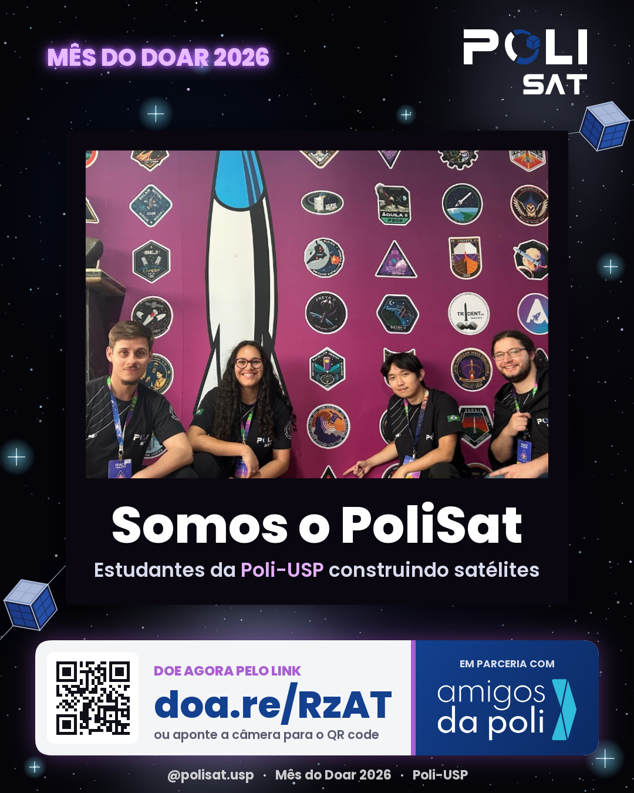
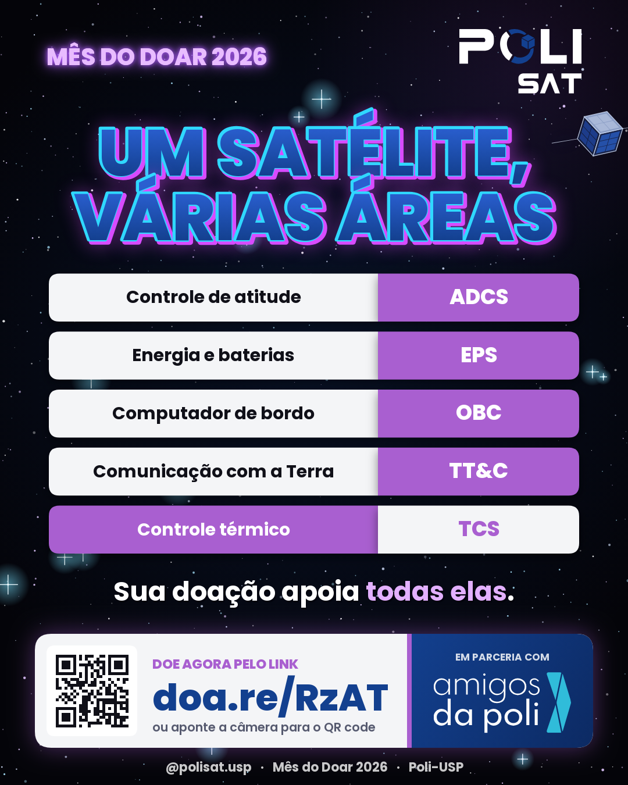
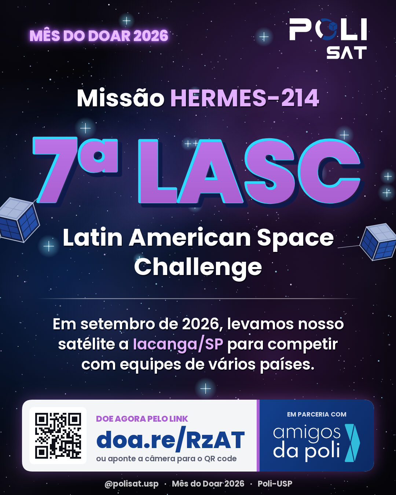
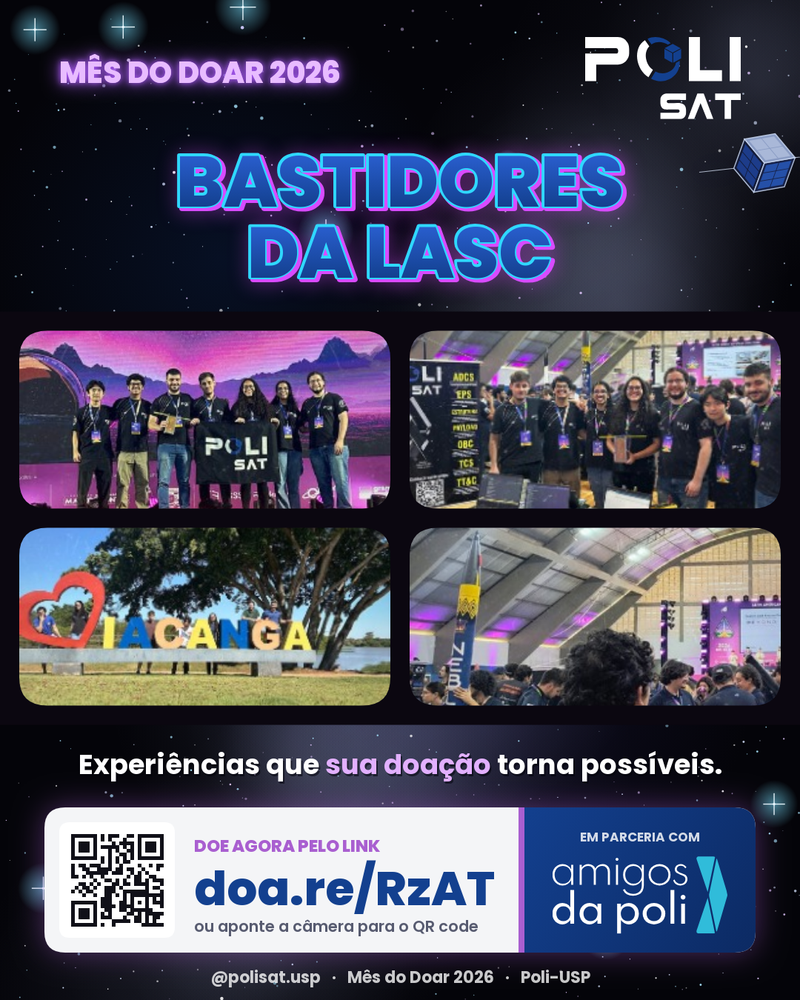
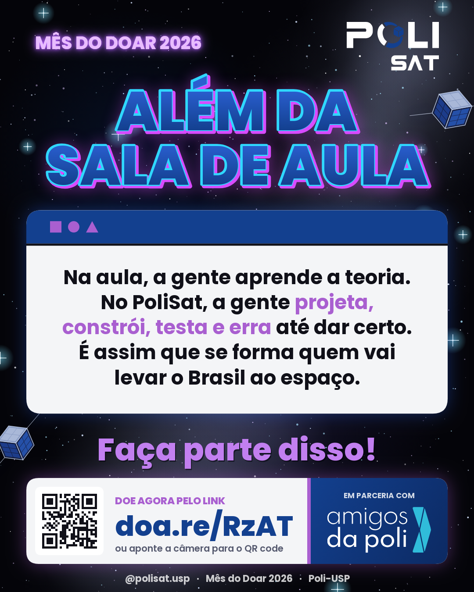
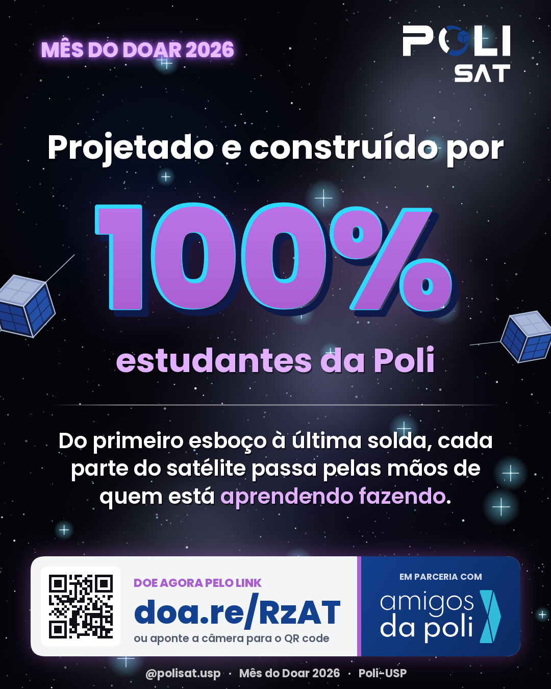
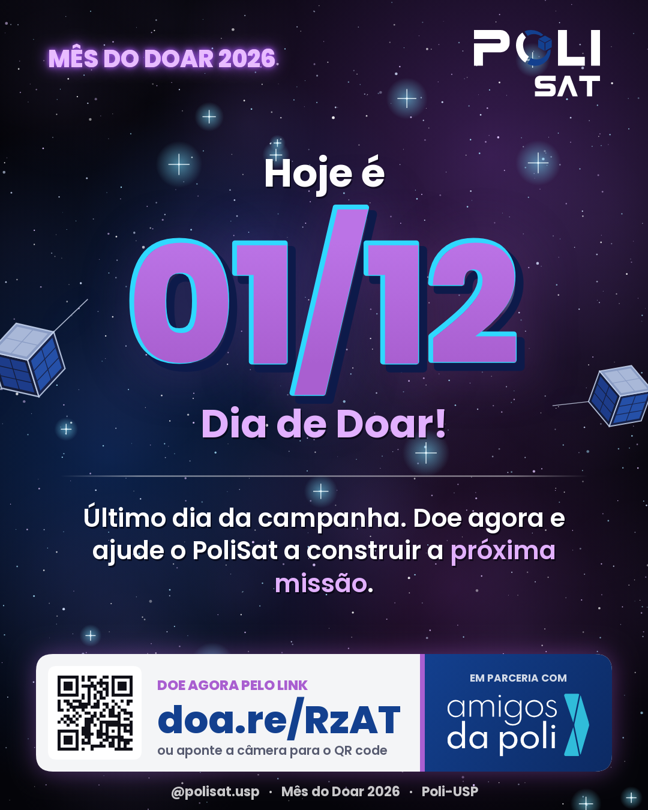

# Mensagens do Mês do Doar · PoliSat

Gerado por `npm run exportar`. Edite os textos em `assets/js/posts.js`.

## 09/11/2026 · Abertura da campanha


**WhatsApp**

```
🚀 *Começou o Mês do Doar!*

Oi! Tudo bem? Eu faço parte do *PoliSat*, o grupo de satélites da Poli-USP. Até *01/12* estamos arrecadando doações, em parceria com a Amigos da Poli, para continuar projetando, construindo e testando satélites feitos por estudantes.

Qualquer valor ajuda, e é rapidinho 💙💜
👉 https://doa.re/RzAT

Se puder, encaminha para quem também acredita na engenharia brasileira! 🛰️
```

**Instagram**

```
Começou o Mês do Doar! 🚀

Até 01/12, sua doação ajuda o PoliSat a projetar, construir e testar satélites feitos por estudantes da Poli-USP. Qualquer valor faz diferença.

💜 Doe: doa.re/RzAT

#MêsDoDoar #DiaDeDoar #PoliSat #AmigosDaPoli #PoliUSP #EngenhariaEspacial
```

## 10/11/2026 · Quem somos



**WhatsApp**

```
🛰️ Você conhece o *PoliSat*?

Somos estudantes da Escola Politécnica da USP que projetam e constroem satélites: da estrutura ao software de bordo. Tudo isso fora da sala de aula, com muita dedicação.

Neste *Mês do Doar*, sua contribuição faz esse trabalho continuar 💙
👉 https://doa.re/RzAT
```

**Instagram**

```
Prazer, somos o PoliSat! 🛰️

Um grupo de estudantes da Poli-USP que transforma teoria em satélite. Neste Mês do Doar, você pode fazer parte da nossa próxima missão.

💜 Doe: doa.re/RzAT

#MêsDoDoar #DiaDeDoar #PoliSat #AmigosDaPoli #PoliUSP #EngenhariaEspacial
```

## 11/11/2026 · Um satélite, várias áreas



**WhatsApp**

```
🔧 Você sabia que um satélite é feito de vários sistemas trabalhando juntos?

No *PoliSat*, estudantes da Poli cuidam de cada um deles: controle de atitude (ADCS), energia (EPS), computador de bordo (OBC), comunicação (TT&C) e controle térmico (TCS).

É engenharia de verdade, aprendida na prática. Ajude a gente a continuar 💜
👉 https://doa.re/RzAT
```

**Instagram**

```
Um satélite, várias engenharias. ⚙️

ADCS, EPS, OBC, TT&C, TCS: cada subsistema é desenvolvido por estudantes do PoliSat. Sua doação no Mês do Doar apoia todos eles.

💜 Doe: doa.re/RzAT

#MêsDoDoar #DiaDeDoar #PoliSat #AmigosDaPoli #PoliUSP #EngenhariaEspacial
```

## 12/11/2026 · Missão HERMES na LASC



**WhatsApp**

```
🏆 Em setembro, o *PoliSat* levou a missão *HERMES-214* para a 7ª *Latin American Space Challenge* (LASC), em Iacanga/SP, competindo com equipes de vários países.

Chegar lá exige muito trabalho, peças, testes e viagem. Com a sua ajuda, a próxima missão vai ainda mais longe 🚀
👉 https://doa.re/RzAT
```

**Instagram**

```
HERMES-214 na 7ª LASC 🚀

Em setembro levamos nosso satélite à Latin American Space Challenge, em Iacanga/SP. Quer ver o PoliSat ir ainda mais longe? Doe no Mês do Doar.

💜 doa.re/RzAT

#MêsDoDoar #DiaDeDoar #PoliSat #AmigosDaPoli #PoliUSP #EngenhariaEspacial
```

## 13/11/2026 · Bastidores da LASC



**WhatsApp**

```
📸 Bastidores da nossa ida à *LASC 2026*!

Noites de montagem, testes até o último minuto e a equipe inteira no palco com a bandeira do *PoliSat*. É esse tipo de experiência que forma engenheiros prontos para o setor espacial.

Ajude mais estudantes a viverem isso 💙💜
👉 https://doa.re/RzAT
```

**Instagram**

```
Bastidores da LASC 2026 📸

Stand, montagem, lançamento e muita equipe. Experiências assim só acontecem com apoio, e o seu faz diferença.

💜 Doe no Mês do Doar: doa.re/RzAT

#MêsDoDoar #DiaDeDoar #PoliSat #AmigosDaPoli #PoliUSP #EngenhariaEspacial
```

## 16/11/2026 · Para onde vai sua doação


**WhatsApp**

```
💡 *Para onde vai a sua doação?*

No *PoliSat*, ela vira componentes e sensores, protótipos e testes em bancada, viagens para competições e ferramentas para o laboratório.

Ou seja: cada real vira engenharia de verdade, feita por estudantes da Poli 🛰️
👉 https://doa.re/RzAT
```

**Instagram**

```
Para onde vai sua doação? 💡

Componentes, testes, competições e laboratório. No PoliSat, cada real vira engenharia.

💜 Doe: doa.re/RzAT

#MêsDoDoar #DiaDeDoar #PoliSat #AmigosDaPoli #PoliUSP #EngenhariaEspacial
```

## 17/11/2026 · Por que doar



**WhatsApp**

```
🎓 Na sala de aula a gente aprende a teoria. No *PoliSat*, a gente projeta, constrói, testa e erra até dar certo.

É assim que se forma quem vai levar o Brasil ao espaço. E você pode fazer parte disso com uma doação de qualquer valor 💜
👉 https://doa.re/RzAT

Obrigado por apoiar! 🚀
```

**Instagram**

```
Vá além da sala de aula. 🎓🚀

No PoliSat, teoria vira satélite. Ajude a formar a próxima geração da engenharia espacial brasileira.

💜 Doe: doa.re/RzAT

#MêsDoDoar #DiaDeDoar #PoliSat #AmigosDaPoli #PoliUSP #EngenhariaEspacial
```

## 18/11/2026 · Como doar


**WhatsApp**

```
✅ *Doar para o PoliSat é simples:*

1️⃣ Acesse https://doa.re/RzAT
2️⃣ Escolha o valor
3️⃣ Conclua a doação

Pronto! Você acabou de ajudar estudantes da Poli a construir satélites 🛰️💙
Se puder, manda para mais alguém também!
```

**Instagram**

```
Como doar em 3 passos ✅

1. Acesse doa.re/RzAT
2. Escolha o valor
3. Conclua a doação

Simples assim. Obrigado por apoiar o PoliSat! 💜

#MêsDoDoar #DiaDeDoar #PoliSat #AmigosDaPoli #PoliUSP #EngenhariaEspacial
```

## 19/11/2026 · Feito por estudantes



**WhatsApp**

```
🔩 Do primeiro esboço à última solda: o satélite do *PoliSat* é feito *100% por estudantes* da Poli-USP.

É o jeito mais concreto de aprender engenharia. E ele só acontece com apoio de gente como você 💜
👉 https://doa.re/RzAT
```

**Instagram**

```
100% feito por estudantes 🔩

Cada parte do nosso satélite passa pelas mãos de quem está aprendendo fazendo. Apoie no Mês do Doar.

💜 doa.re/RzAT

#MêsDoDoar #DiaDeDoar #PoliSat #AmigosDaPoli #PoliUSP #EngenhariaEspacial
```

## 20/11/2026 · Toda doação conta


**WhatsApp**

```
💜 *Toda doação conta!*

Não precisa ser muito: R$ 10, R$ 50 ou R$ 100. Somadas, as doações viram peças, testes e missões do *PoliSat*.

Se cada pessoa que receber esta mensagem doar um pouquinho, a gente vai longe 🚀
👉 https://doa.re/RzAT
```

**Instagram**

```
Toda doação conta 💜

R$ 10, R$ 50 ou R$ 100: juntas, as doações viram peças, testes e missões. Faça a sua no Mês do Doar.

👉 doa.re/RzAT

#MêsDoDoar #DiaDeDoar #PoliSat #AmigosDaPoli #PoliUSP #EngenhariaEspacial
```

## 23/11/2026 · Faltam 8 dias


**WhatsApp**

```
⏳ *Faltam 8 dias* para o Dia de Doar (01/12)!

O Mês do Doar está na reta final e cada doação ajuda o *PoliSat* a seguir construindo satélites na Poli-USP.

Não deixa para a última hora 😉
👉 https://doa.re/RzAT
```

**Instagram**

```
Faltam 8 dias! ⏳

O Mês do Doar termina em 01/12, no Dia de Doar. Doe hoje e ajude o PoliSat a decolar.

💜 doa.re/RzAT

#MêsDoDoar #DiaDeDoar #PoliSat #AmigosDaPoli #PoliUSP #EngenhariaEspacial
```

## 24/11/2026 · Para quem é da Poli


**WhatsApp**

```
🏛️ *Para quem é (ou foi) da Poli:*

Você sabe que os grupos de extensão são onde a engenharia ganha vida. Hoje, o *PoliSat* é um deles, formando estudantes que constroem satélites de verdade.

Que tal retribuir e ajudar a próxima geração? 💙💜
👉 https://doa.re/RzAT
```

**Instagram**

```
Para quem é da Poli 🏛️

Os grupos de extensão fazem parte da formação politécnica. Retribua e ajude o PoliSat a formar a próxima geração.

💜 doa.re/RzAT

#MêsDoDoar #DiaDeDoar #PoliSat #AmigosDaPoli #PoliUSP #EngenhariaEspacial
```

## 25/11/2026 · Uma equipe, uma missão


**WhatsApp**

```
👩‍🚀👨‍🚀 Por trás de cada satélite tem uma equipe inteira de estudantes apaixonados por espaço.

No *PoliSat* a gente aprende junto, constrói junto e comemora junto. Ajude essa equipe a continuar 💜
👉 https://doa.re/RzAT
```

**Instagram**

```
Uma equipe, uma missão 🛰️

Por trás de cada satélite, estudantes da Poli construindo o futuro juntos. Apoie no Mês do Doar.

💜 doa.re/RzAT

#MêsDoDoar #DiaDeDoar #PoliSat #AmigosDaPoli #PoliUSP #EngenhariaEspacial
```

## 26/11/2026 · Doe com confiança


**WhatsApp**

```
🤝 Ficou na dúvida de como funciona?

A doação para o *PoliSat* é feita pela *Amigos da Poli*, associação que apoia projetos e estudantes da Escola Politécnica da USP.

É só acessar o link e escolher o valor 💙
👉 https://doa.re/RzAT
```

**Instagram**

```
Doe com confiança 🤝

A campanha do PoliSat é feita em parceria com a Amigos da Poli, que apoia projetos e estudantes da Escola Politécnica.

💜 doa.re/RzAT

#MêsDoDoar #DiaDeDoar #PoliSat #AmigosDaPoli #PoliUSP #EngenhariaEspacial
```

## 27/11/2026 · Faltam 4 dias


**WhatsApp**

```
⏰ *Faltam só 4 dias!*

O Mês do Doar termina em 01/12. Se você já doou, muito obrigado! 💜 Agora pedimos uma coisa: encaminha esta mensagem para 3 amigos.

Se ainda não doou, dá tempo:
👉 https://doa.re/RzAT
```

**Instagram**

```
Faltam só 4 dias! ⏰

Doe e marque 3 amigos que também apoiariam o PoliSat.

💜 doa.re/RzAT

#MêsDoDoar #DiaDeDoar #PoliSat #AmigosDaPoli #PoliUSP #EngenhariaEspacial
```

## 30/11/2026 · É amanhã


**WhatsApp**

```
🚨 *É amanhã!* 01/12 é o *Dia de Doar* e o último dia da nossa campanha.

Se você ainda não doou para o *PoliSat*, essa é a hora. Se já doou, obrigado demais! Encaminhar esta mensagem também ajuda muito 💜
👉 https://doa.re/RzAT
```

**Instagram**

```
É amanhã! 🚨

01/12 é o Dia de Doar e o último dia da campanha do PoliSat. Ainda dá tempo!

💜 doa.re/RzAT

#MêsDoDoar #DiaDeDoar #PoliSat #AmigosDaPoli #PoliUSP #EngenhariaEspacial
```

## 01/12/2026 · Dia de Doar



**WhatsApp**

```
💜 *Hoje é o Dia de Doar!*

É o último dia da campanha do *PoliSat* no Mês do Doar. Sua doação de hoje ajuda estudantes da Poli-USP a construir a próxima missão 🛰️

👉 https://doa.re/RzAT

Obrigado a todo mundo que apoiou até aqui! 🚀
```

**Instagram**

```
Hoje é Dia de Doar! 💜

Último dia da campanha do PoliSat. Doe agora e faça parte da nossa próxima missão.

👉 doa.re/RzAT

#MêsDoDoar #DiaDeDoar #PoliSat #AmigosDaPoli #PoliUSP #EngenhariaEspacial
```
